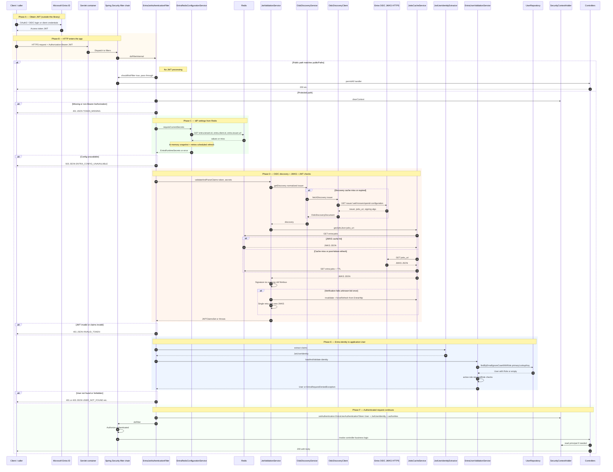
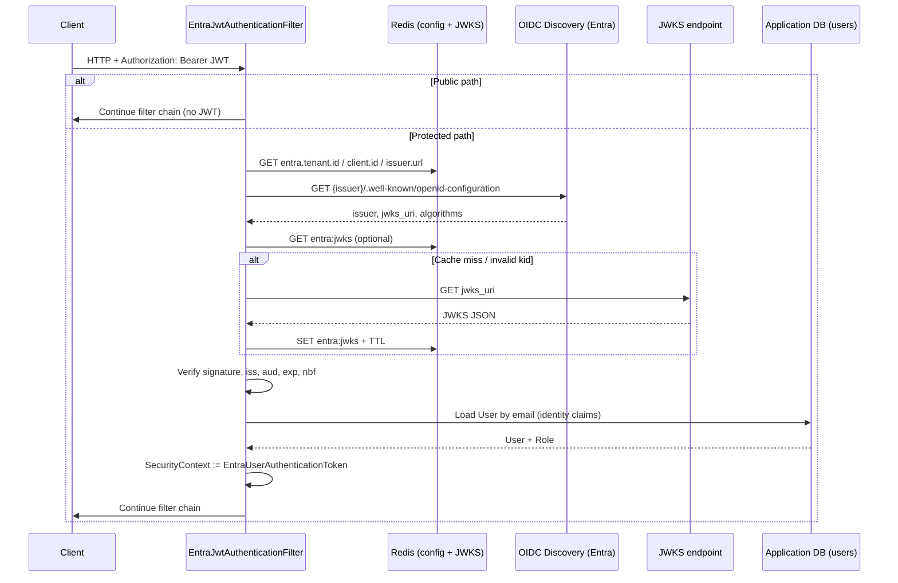

# Microsoft Entra OIDC JWT security

This module can enforce **Bearer JWT** authentication for servlet-based Spring Boot applications using **OIDC discovery**, **JWKS signature verification**, and **database-backed user authorization**.

## Request flow logging

When `mvp.persistence.security.entra.enabled=true`, Entra-related components log diagnostic detail at **DEBUG** (for example `EntraJwtAuthenticationFilter`, `JwtValidationService`, `EntraUserValidationService`, JWKS/OIDC clients). Token values are never logged in full; length and a short prefix may appear via `EntraJwtLogSupport.tokenHint`.

Example (with root logger at INFO, enable DEBUG for the package below):

```text
DEBUG c.c.p.s.e.EntraJwtAuthenticationFilter - Entra JWT request enter method=GET uri=/dashboard/api/export
DEBUG c.c.p.s.e.EntraJwtAuthenticationFilter - Entra JWT: TOKEN_RECEIVED len=842 prefix=eyJhbGci...
DEBUG c.c.p.s.e.JwtValidationService - Entra JWT validation: JWT_VALIDATE_OK issuer=...
DEBUG c.c.p.s.e.EntraJwtAuthenticationFilter - Entra JWT: USER_AUTHORIZED userId=... email=... role=...
```

Enable **DEBUG** for `com.customcharge.persistencelayer.security.entra` in `application.yml` when troubleshooting; keep **WARN** or **INFO** at root in production to avoid noise.

## Enablement

1. Ensure `mvp.persistence.redis.enabled=true` and configure **only** `mvp.persistence.redis.host` / `port` / `password` / `database` (same Redis as cache and other persistence features). Entra reads `entra.tenant.id`, `entra.client.id`, and `entra.issuer.url` from that server via the shared `StringRedisTemplate` — there is no separate Entra Redis connection.

   **Docker:** [ENTRA_IDP_MODES.md](../../../docs/ENTRA_IDP_MODES.md) (`ENTRA_IDP_MODE=mock|real` via `.env` + Redis seed). Mock E2E: [DOCKER_OIDC_E2E_TEST.md](../../../docs/DOCKER_OIDC_E2E_TEST.md). There is **no** Spring form login on backend services when Entra is enabled.
2. Set `mvp.persistence.security.entra.enabled=true`.
3. Populate Redis keys (see below).
4. Ensure each caller has a corresponding row in the `users` table (matched by email / UPN-style primary lookup).
5. For Entra **`groups`** → `users.groups` resolution, ensure **`entra_guid_entity_map`** is populated (Liquibase changeSet `016-entra-guid-entity-map` in this module, or `init-entra-guid-entity-map.sql` for manual runs). The table stores Entra group object ids (`guid`) and intranet **`entity_code`** values. `EntraGuidEntityResolutionService` reads the table at startup and maps known object ids to entity codes when syncing users; unmapped claim values are stored as-is.

Auto-configuration: `EntraOidcSecurityPropertiesAutoConfiguration` (binds `mvp.persistence.security.entra.*`). Servlet security and **`@EnableScheduling`** (for periodic Redis config refresh) are declared on `EntraOidcWebSecurityConfiguration`. On startup, `EntraOidcStartupWarmup` pre-fetches OIDC discovery and JWKS when Redis IdP keys are present so `entra:jwks` is populated early. Runtime collaborators are `@Service` / `@Component` beans in this package, gated by `@ConditionalOnEntraOidcSecurityEnabled` so they are not created when Entra is disabled despite `@ComponentScan("com.customcharge")` on consuming apps. Only `WebClient` and `Clock` remain as explicit `@Bean` definitions in `EntraHttpConfiguration`.

## Redis configuration keys

| Redis key | Purpose |
|-----------|---------|
| `entra.tenant.id` | Entra tenant ID (informational; issuer URL typically embeds tenant) |
| `entra.client.id` | Application client ID; used as expected JWT `aud` |
| `entra.issuer.url` | Issuer base URL used for `/.well-known/openid-configuration` |
| `entra:jwks` | Cached JWKS JSON (written by the library with TTL) |

**Issuer URL examples**

| Mode | `entra.issuer.url` | Discovery / JWKS |
|------|-------------------|------------------|
| Mock (local) | `http://mock-entra:9000` | Mock server; JWT `iss` is still Microsoft v2.0 shape |
| Real Entra | `https://login.microsoftonline.com/<tenant-id>/v2.0` | Microsoft OIDC |

After switching mock ↔ real, re-seed Redis and delete `entra:jwks` (see [ENTRA_IDP_MODES.md](../../../docs/ENTRA_IDP_MODES.md)).

Changing Redis values is picked up on the **scheduled refresh** interval (`mvp.persistence.security.entra.entra-config-refresh-interval-ms`, default 60000 ms) and on demand when secrets are missing from the in-memory snapshot. Scheduling is enabled whenever Entra servlet security is active (`@EnableScheduling` on `EntraOidcWebSecurityConfiguration`); it no longer depends on a separate auto-configuration class.

## Troubleshooting

### `AuthenticationCredentialsNotFoundException` on `@PreAuthorize` methods

This exception means **method security ran with no `Authentication` in the `SecurityContext`**. It is **not** the same as an empty JWKS cache.

Typical causes:

- **No `Authorization: Bearer` header** on a protected route: the JWT filter returns **401** and the controller should not run; if you still see this exception, check for **async** dispatch, **internal calls** (self-invocation), or a **second `SecurityFilterChain`** that permits the request without installing authentication.
- **`mvp.persistence.security.entra.enabled=false`** while controllers still use `@PreAuthorize`: enable Entra (and Redis) for those APIs, or remove / relax method security for that deployment.
- **Path treated as public** in `mvp.persistence.security.entra.public-paths` so the JWT filter is skipped (`shouldNotFilter`), but the handler method still has `@PreAuthorize`: do not list API paths as public unless the method is also unsecured.

### JWKS / `entra:jwks` missing in Redis

JWKS is **written on first use** (after Redis IdP keys exist): `JwtValidationService` calls `JwksCacheService.getJwksJson`. If **`entra.tenant.id` / `entra.client.id` / `entra.issuer.url`** are missing, `EntraRedisConfigurationService` never resolves secrets and JWKS fetch never runs — fix Redis seeding and **database index** (`mvp.persistence.redis.database`) must match the seed script.

After startup warm-up (`EntraOidcStartupWarmup`), check logs for **"Entra OIDC startup warm-up completed"** or **"warm-up skipped"** / **"warm-up failed"**. Verify keys: `redis-cli GET entra:jwks` (non-empty JSON). If keys rotated, delete `entra:jwks` and retry (see [ENTRA_IDP_MODES.md](../../../docs/ENTRA_IDP_MODES.md)).

## Request flow (sequence)

### Head-to-toe (Mermaid)

The diagram below runs from **obtaining the JWT at Entra** through **your controller response**. Dashed steps are optional or conditional.



### Background (not on every request)

- **`EntraRedisConfigurationService`**: `@Scheduled` re-reads Entra keys from Redis so tenant/client/issuer can change without restart.
- **`OidcDiscoveryService`**: In-memory TTL cache for the discovery document per issuer.

### Earlier short overview (same flow, fewer steps)



## JWT validation rules

- **Signature**: RSA or EC keys from JWKS; on failure the JWKS Redis entry is invalidated and keys are refetched once.
- **Issuer**: Must match the `issuer` from OIDC discovery.
- **Audience**: Must include `clientId` from Redis (plus any `additional-accepted-audiences` if configured).
- **Time**: `exp` and `nbf` validated with a small clock skew.

## User identity and database checks

Claims are read in priority order for lookup: `email`, `preferred_username`, `upn`, then `sub`.

The service loads `User` with `LEFT JOIN FETCH role` by **case-insensitive email match** against `primaryLookupKey`.

Failures:

| Condition | HTTP |
|-----------|------|
| No Bearer token | 401 `TOKEN_MISSING` |
| Expired access token (`exp` past skew) | 401 `TOKEN_EXPIRED` (message prompts user to sign in again) |
| Invalid JWT | 401 `INVALID_TOKEN` |
| No matching user | 401 `USER_NOT_FOUND` |
| Inactive user | 403 `USER_INACTIVE` |
| Missing role | 403 `MISSING_APPLICATION_ROLE` |
| Required role mismatch | 403 `INSUFFICIENT_ROLE` |
| Redis Entra config incomplete / unavailable at startup | 503 `ENTRA_CONFIG_UNAVAILABLE` (filter path) |

## Downstream access

Inject the authenticated principal:

```java
import com.customcharge.persistencelayer.entities.User;
import org.springframework.security.core.Authentication;
import org.springframework.security.core.context.SecurityContextHolder;

import java.util.UUID;

Authentication auth = SecurityContextHolder.getContext().getAuthentication();
if (auth instanceof EntraUserAuthenticationToken token) {
    User user = token.getUser();
    JwtUserIdentity entra = token.getEntraIdentity();
    UUID id = user.getId();
}
```

## Public endpoints

Configure Ant-style patterns under `mvp.persistence.security.entra.public-paths` (defaults include `/actuator/health` and OpenAPI UI paths).

### Entra lifecycle user deactivation (webhook)

Microsoft Entra **Lifecycle Workflows** (or similar automation) can call the **dashboard service** over HTTPS to mark the matching application user inactive when the directory account is disabled. The REST controller lives in `Corp.microservice.custom-charges-dashboards` (`EntraUserLifecycleWebhookController`); deactivation uses `EntraLifecycleUserDeactivationService` from this library.

- **Route:** `POST /api/auth/entra/lifecycle/user/deactivate` (after servlet `context-path`, e.g. `http://localhost:8001/dashboard/api/auth/entra/lifecycle/user/deactivate`).
- **Auth:** set `mvp.persistence.security.entra.lifecycle-webhook-secret` on the dashboard app (environment variable / secret manager — do not commit). Send the same value in header **`X-Entra-Lifecycle-Secret`**.
- **Body:** JSON `{"email":"<primary-email>"}` — must match `users.email` the same way as Entra JWT primary lookup (case-insensitive).
- **Responses:** `204` when a user row exists (already inactive is still `204`); `404` when no user matches; `401` when the secret is wrong or missing; `503` when `lifecycle-webhook-secret` is not configured (endpoint disabled); `400` when the body is missing or invalid.

Dashboard `application.yaml` lists public paths for this route. If you replace `public-paths` entirely, add `/api/auth/entra/lifecycle/user/deactivate` and `/dashboard/api/auth/entra/lifecycle/user/deactivate`.

Example (replace host, secret, and email):

```bash
curl -sS -i -X POST "http://localhost:8001/dashboard/api/auth/entra/lifecycle/user/deactivate" \
  -H "Content-Type: application/json" \
  -H "X-Entra-Lifecycle-Secret: YOUR_CONFIGURED_SECRET" \
  -d '{"email":"user@contoso.com"}'
```

## curl examples

Health (no token, if permitted):

```bash
curl -sS -i "http://localhost:8080/actuator/health"
```

Protected API:

```bash
curl -sS -i -H "Authorization: Bearer eyJhbGciOi..." "http://localhost:8080/api/your-endpoint"
```

## Testing

Unit tests for Entra security components live under `src/test/java/com/customcharge/persistencelayer/security/entra/`. The lifecycle webhook controller is tested in the dashboard module (`com.customcharge.dashboard.security.entra`). Run:

```bash
bash ./gradlew test --tests 'com.customcharge.persistencelayer.security.entra.*'
```

```bash
cd Corp.microservice.custom-charges-dashboards && ./gradlew test --tests 'com.customcharge.dashboard.security.entra.*'
```

Full integration tests against Redis + PostgreSQL are left to consuming services; this library focuses on reusable components and focused unit coverage.

## Local mock Entra (no real tenant)

For a **browser UI + mock OIDC/JWKS + minted JWTs** (no Microsoft account), see the **`mock-entra/`** folder: `mock-entra/README.md` and run `node mock-entra/server.mjs`.
